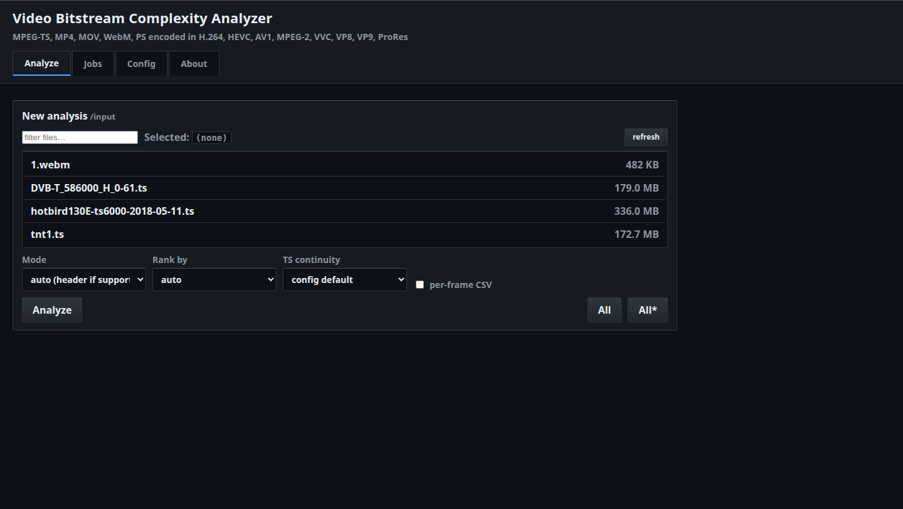
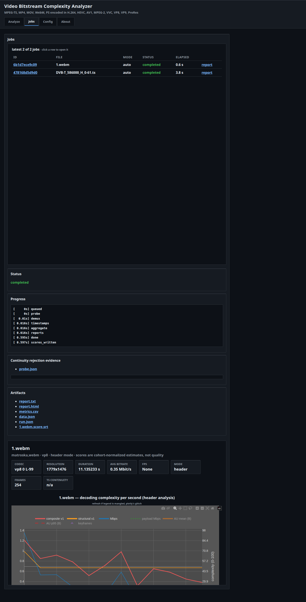
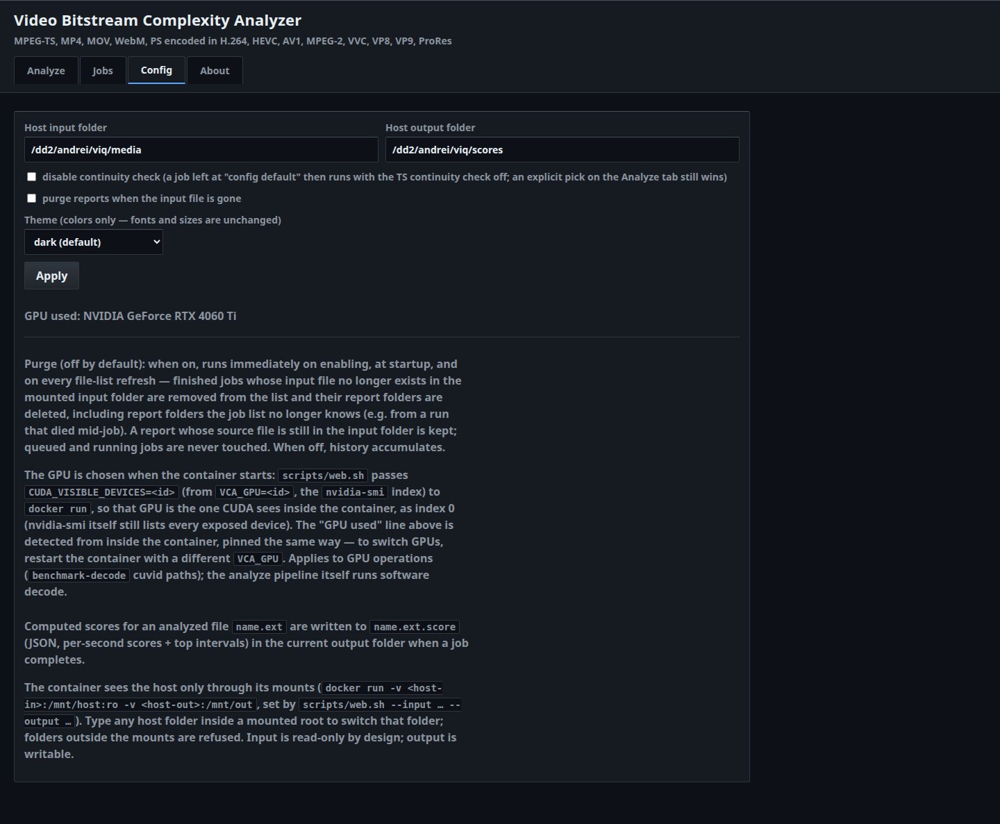
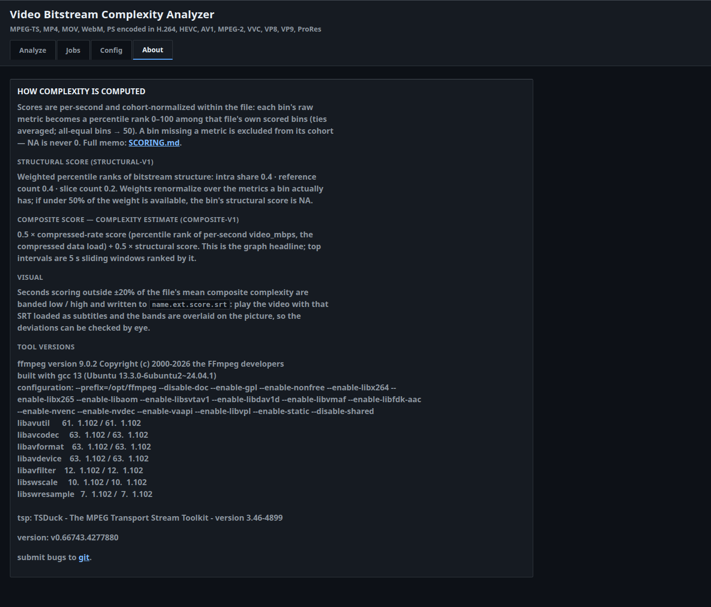

# VCO — Video Bitstream Complexity Analyzer

`vca` is a local, offline CLI (plus a single-user web UI) that analyzes compressed video
(MPEG-TS, MP4, MOV, WebM, PS containing H.264, HEVC, AV1, MPEG-2, VVC, VP8, VP9, ProRes)
and produces **PTS-aligned
per-second** measurements of compressed data load, bitstream structural workload, and — in
a separate opt-in mode — measured decode cost. It writes TXT, CSV, JSON, and a
self-contained interactive HTML report whose headline chart plots **decoding complexity
with a point at every second of video** (inline Plotly, renders offline and in the Docker
web UI). Completed web-UI jobs also write a compact per-second **score file**
(`<basename>.<ext>.score`) to a configurable output folder.

The analyzer keeps three concepts **separate** and never conflates them:

- **(A) source/content complexity** — intrinsic visual difficulty (requires pixel decode; opt-in),
- **(B) encoded-bitstream decoding workload** — syntax/structure the decoder processes,
- **(C) encoding outcome/quality** — VMAF/PSNR/SSIM of encodes.

Unavailable metrics are `null` in JSON and `NA` in CSV — never zero. Every metric carries a
status and provenance. Timestamp anomalies are detected, repaired only under a documented
policy, and always reported.

## Hard product rules

- **MPEG-TS continuity gate:** before analysis, `tsp -P continuity --json-line` (TSDuck)
  validates the file. Under the default `require` policy, **any** continuity error rejects the
  file: exit code **5**, `continuity.json` + `rejection.txt`, and **no analysis outputs**.
  `--fix` is never used; the input is never modified.
- **No pixel decode** in fast/header modes; no `shell=True`; no network calls; inputs are
  never modified; outputs are never overwritten without `--overwrite`/`--force`.
- Scores are versioned, cohort-normalized, explainable estimates — never claims of decoder
  complexity or visual quality from packet bytes alone. The full scoring pipeline
  (data sources, percentile ranks, weights, composite, top-intervals) is documented in
  **`SCORING.md`**.

## Install

Everything runs from the published Docker image `boris271142/vca` (Docker Hub)
or from the compiled CLI wheel in `wheel/`. No sources are needed — this repo
is the distribution tree.

### Web UI — `./setup.sh` (recommended)

```bash
./setup.sh            # interactive: port, bind address, folders, GPU
./install.sh ...      # same entry, same flags (wrapper around setup.sh)
```

`setup.sh` checks Docker, pulls `boris271142/vca:latest`, asks for the web UI
**port** (default 9081), **bind** (`localhost` = loopback only, default;
`0.0.0.0` = all interfaces; or a specific IP), the **input** (videos,
read-only), **output** (score files) and **reports** folders, probes
`nvidia-smi` and pins a GPU when present, starts the container, health-tests
it, and prints the URL. Non-interactive:

```bash
./setup.sh --yes --port 9081 --bind localhost \
    --input ~/vca-media --output ~/vca-scores --reports ~/vca-reports --gpu 1
./setup.sh --no-gpu            # skip GPU entirely
```

### CLI — compiled wheel

x86_64 Linux, Python 3.12 (compiled modules only, no sources shipped):

```bash
python3.12 -m venv ~/.venvs/vca && source ~/.venvs/vca/bin/activate
pip install wheel/vco-0.1.0-cp312-cp312-linux_x86_64.whl
vca --version
```

Requires FFmpeg 9.x + ffprobe and TSDuck `tsp` 3.46+ on PATH
(`vca capabilities --json` shows what was found; the Docker image bundles them).

### CLI via Docker (no Python at all)

```bash
docker run --rm --entrypoint vca \
  -v "$PWD/media:/input:ro" -v "$PWD/reports:/reports" \
  boris271142/vca:latest analyze /input/<your-file.ts> --mode header --out /reports/out
```

## Quick start

```bash
vca --version
vca capabilities --json
vca probe input.ts
vca continuity input.ts
vca analyze input.ts --mode fast --out ./reports/input
vca analyze input.ts --mode header --frames --out ./reports/input
vca analyze input.ts --mode deep --out ./reports/input   # H.264 motion (export_mvs); AV1 QP needs aomdec
vca benchmark-decode input.ts --runs 3 --out ./reports/bench   # measured decode throughput
vca compare ref.mp4 cand1.mp4 cand2.mp4 --manifest ./exp --out ./reports/cmp   # PSNR/SSIM/VMAF + Pareto set, no single "best"
vca optimize input.ts --analysis ./reports/input/data.json --constraint "vmaf>=85" --constraint "bitrate<=1000000" --objective encode_time   # constrained recommendations + full-file validation
vca serve --input-dir ./input --reports-dir ./reports --output-dir ./scores   # web UI on 127.0.0.1:8666
```

Exit codes: `0` success · `1` internal · `2` usage/config · `3` unsupported/missing tools ·
`4` partial · `5` **rejected by TS continuity gate** · `130` interrupted.

For scripted single-file runs with every CLI option exposed as an argument, use
`scripts/analyze.sh` (see `scripts/EXAMPLES.md` for worked examples on real captures).

## Web UI

`vca serve` serves a tabbed UI — **Analyze** (clickable file list + mode/rank-by/frames/
continuity controls), **Jobs** (live status via SSE, job history across restarts, report
links), **Config** (host folder mapping). Gray "Autodesk Maya"-style theme throughout,
including the Plotly report chart.

| | |
|---|---|
|  |  |
|  |  |

- **Input folder** (read-only) and **output folder** are both mapped in the Config tab:
  type a host folder inside the mounted root and Apply switches it. Folders outside the
  mounts are refused.
- When a job completes, per-second scores are written to
  **`<output-folder>/<basename>.<ext>.score`** (JSON, schema `score-v1`: per-second
  `complexity` / `structural` / `compressed` / `motion` / `decode_cost` + top intervals;
  unavailable scores stay `null`, never 0). `--output-dir` sets the output root; default
  on a plain host run is `reports/scores/`.

### Dockerized web UI

```bash
./setup.sh                                                   # first run: pull + configure + start
scripts/web.sh start --input ~/vca-media --output ~/vca-scores
scripts/web.sh status | logs | stop | restart
```

`web.sh` runs `boris271142/vca:latest` on port **9081** with `--input` mounted
read-only at `/mnt/host` and `--output` mounted writable at `/mnt/out` (the
Config tab maps folders inside these mounts; the UI shows the container↔host
mapping). `VCA_GPU=<n>` exposes nvidia-smi GPU `<n>` to the container (pinned
by UUID). All knobs are env-overridable (`VCA_PORT`, `VCA_HOST_DIR`,
`VCA_OUT_DIR`, …).

## Scripts

| Script | Purpose |
|---|---|
| `setup.sh` (repo root) | First-run installer: pull image, port/bind, folder mappings, GPU probe, start, health-test |
| `install.sh` (repo root) | Same installer, findable name (wrapper around `setup.sh`) |
| `scripts/analyze.sh` | Single-file analysis with **all** `vca analyze` options as arguments; results stored per run in a timestamped folder (JSON/text/CSV/HTML) |
| `scripts/EXAMPLES.md` | Worked examples with exact commands, exit codes, and output-file inventory |
| `scripts/web.sh` | Start/stop/restart/status/logs for the Dockerized web UI with `--input`/`--output` folder mounts |

## Docs

- `SCORING.md` — how scores are computed from video properties (the scoring memo)
- `docs/metrics.md` — metric semantics
- `docs/codec-support.md` — codec support matrix
- `docs/delivery.md` — Docker image + wheel details
- `docs/config.yaml` — example config (scores, weights, tool paths)

Published at `github.com/suedenglehem/vca-cython` (branch `main`).
